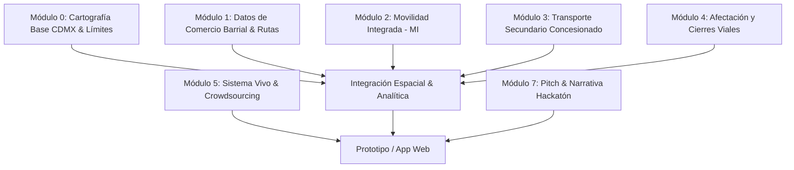

# Backlog y To-Do List del Proyecto: Comercio Popular y Movilidad CDMX
> **Chilangotón 2026 — Reto 1: Comercio Popular y Barrial**  
> *Enfoque: Resiliencia económica barrial, accesibilidad ciudadana, logística popular y movilidad urbana.*

---

## 🧭 Visión General de la Integración

El reto se centra en el **comercio popular y barrial** (1,367 tianguis, 329 mercados públicos, 51 rutas de mercados sobre ruedas y 224 concentraciones comerciales). Integrar la capa de **Transporte, Movilidad y Cartografía de la CDMX** permite:
1. **Para la ciudadanía / compradores:** 
   - Saber qué tianguis o mercado está activo hoy cerca de su ubicación o trabajo sobre un mapa interactivo de la ciudad.
   - Cómo llegar de la forma más económica y rápida (Movilidad Integrada vs. transporte secundario).
   - Seguir a sus tianguis móviles y puesteros favoritos a lo largo de su ruta semanal.
   - Evitar embotellamientos sabiendo qué calles están cerradas por instalación de tianguis.
2. **Para las y los comerciantes:** 
   - Rutas óptimas de abasto desde centros mayoristas (CEDA, La Merced) hasta sus puntos de venta.
   - Un canal directo y sin intermediarios para mantener viva y actualizada su información (días festivos, cambios de sede, medios de pago).
3. **Para la movilidad y la política pública:** 
   - Prever afectaciones viales temporales (cierres de calles programados de lunes a domingo).
   - Detectar "desiertos de movilidad" y "desiertos de abasto fresco" en colonias periféricas.
   - Contrastar los mercados populares contra las unidades económicas formales (DENUE INEGI).

---

## 🗂️ Arquitectura Modular del Proyecto

Para permitir trabajar en paralelo sin bloqueos, el proyecto se divide en 8 áreas independientes:

---

## 📋 To-Do List Modular (Backlog "Rascable")

> Cada tarea indica su **Nivel de Dependencia** (`[100% Independiente]` o `[Depende de...]`) y su **Dificultad** (`Baja`, `Media`, `Alta`). Puedes tomar cualquier tarea independiente en el orden que prefieras.

---

### MÓDULO 0: Infraestructura Cartográfica Base de la CDMX (Lienzo Geográfico)

> Descarga y estandarización de las capas vectoriales sobre las que se montarán todos los datos (alcaldías, colonias, malla vial y unidades económicas).

- [x] **0.1 Descargar polígonos de límites de la CDMX y las 16 Alcaldías** `[Hecho]`
  - Obtenido GeoJSON oficial de las 16 alcaldías en `data/raw/cartografia/alcaldias.geojson`.
- [ ] **0.2 Descargar polígonos de Colonias de la CDMX** `[100% Independiente] [Dificultad: Baja]`
  - Fuente: Catálogo oficial IECM / ADIP (~1,814 colonias con claves oficiales).
  - Permite vincular la columna `colonia` de tianguis y mercados con su polígono real para agregaciones y mapas de calor.
- [ ] **0.3 Descargar Red Vial de la CDMX (Malla de Calles y Avenidas)** `[100% Independiente] [Dificultad: Media]`
  - Fuente: OpenStreetMap (extracto CDMX vía Geofabrik / Overpass) o Red Vial Oficial SEMOVI.
  - Extraer ejes viales, vías primarias, secundarias y locales. Crucial para proyectar sobre qué tramo de calle exacto se monta cada tianguis.
- [ ] **0.4 Descargar Unidades Económicas de Comercio al por Menor (DENUE INEGI)** `[100% Independiente] [Dificultad: Media]`
  - Descargar registros de CDMX del DENUE (código SCIAN 46: Comercio al por menor: abarrotes, fruterías, carnicerías, pollerías, minisúpers, tiendas de autoservicio).
  - Permite comparar la presencia del comercio popular vs. tiendas de autoservicio/conveniencia por colonia.
- [x] **0.6 Descargar y mapear municipios conurbados de la Zona Metropolitana (ZMVM)** `[Hecho]`
  - Obtenidos los 60 municipios metropolitanos del Estado de México e Hidalgo (Naucalpan, Tlalnepantla, Ecatepec, Nezahualcóyotl, Chimalhuacán, Huixquilucan, Chalco, etc.) en `data/raw/cartografia/zmvm_edomex.geojson` para dar contexto geográfico continuo a todo el Valle de México.
- [x] **0.7 Exploración y catálogo de APIs de consultas de mapas y servicios geoespaciales de la CDMX** `[Hecho]`
  - Investigadas y probadas con éxito las APIs de CDMX: CKAN API v3 (Datastore & SQL en vivo), Ecobici GBFS v2.3 en tiempo real, GeoServer WFS SIG CDMX (GeoJSON directo de 44 capas oficiales incluyendo Atlas de Riesgo por Inundación, CETRAM, transporte concesionado, Metrobús y Metro), Open-Meteo CDMX y OSRM ruteo caminable.
  - Generado catálogo exhaustivo con matriz comparativa, fichas técnicas, payloads reales y 6 ideas de alto impacto para el Hackatón en `data/docs/apis_cdmx.md`.

---

### MÓDULO 1: Datos de Comercio Popular, Tipología (Fijo vs. Móvil) y Rutas

- [x] **1.1 Inventario de bases de datos existentes** `[Hecho]`
  - Tianguis (1,367), Mercados Públicos (329), Mercados sobre Ruedas (51), Concentraciones (224), Solicitudes FONDESO, Muestra Mercomuna.
- [x] **1.2 Clasificación tipológica formal: Fijos vs. Móviles (Itinerantes)** `[Hecho]`
  - Etiqueta canónica `tipo_comercio` integrada en `directorio_comercio_popular` (.json/.csv) y en cada dataset base:
    - `FIJO` (553 espacios): Mercados Públicos (329 inmuebles con cédula SEDECO) y Concentraciones comerciales (224 en vía pública).
    - `MOVIL` (1,418 espacios): Tianguis semanales (1,367) y paradas de Mercados Sobre Ruedas (51).
- [x] **1.3 Normalización de horarios y días de instalación** `[Hecho]`
  - Horarios parseados con precisión decimal (`hora_apertura`, `hora_cierre`, `horario_estimado`):
    - Cobertura al 100% (1,971 registros sin nulos; apertura entre 6.0 y 9.0 hrs, cierre entre 16.0 y 19.0 hrs).
    - Matriz de 7 banderas booleanas por día (`lunes` a `domingo`) en el directorio unificado.
    - Función reproducible `esta_abierto(record, dia, hora)` para responder en vivo *"¿Qué comercio está abierto ahora?"*.
- [x] **1.4 Trazabilidad y seguimiento de Rutas de Mercados Sobre Ruedas (MSR)** `[Hecho]`
  - Generados `data/processed/msr_rutas_itinerantes.json` y `.csv`:
    - 13 rutas gremiales agrupadas (RUTA 1 a RUTA 10, variantes A/B y MINI RUTA).
    - Paradas ordenadas cronológicamente de lunes a domingo con secuencia semanal, georreferenciación WGS84, alcaldía, colonia y oferentes.
    - Generado dataset complementario GIS-ready `data/processed/msr_rutas_paradas_itinerantes.csv` (51 paradas geolocalizadas) para mapeo directo.
- [x] **1.5 Catálogo de Centros de Abasto Mayoristas** `[Hecho]`
  - Creados `data/processed/centros_abasto_mayoristas.json` y `.csv` con 8 nodos estratégicos de suministro georreferenciados:
    - Central de Abasto de Iztapalapa (CEDA - 327 ha, mayor central mayorista del mundo)
    - Mercado de La Merced - Nave Mayor (hortalizas, legumbres, víveres y canasta básica)
    - Mercado de La Merced - Nave Menor (cárnicos, embutidos y derivados lácteos)
    - Mercado de Sonora (herbolaria tradicional, plantas medicinales y alfarería)
    - Mercado de Jamaica (gran centro de distribución florícola 24 horas)
    - Mercado de La Nueva Viga (segundo mercado mayorista de mariscos del mundo)
    - Mercado de La Viga (polo semimayorista histórico de pescados y mariscos)
    - Mercado de San Juan Pugibet (abasto semimayorista gourmet y carnes selectas)
    - Cada nodo incluye: ID, nombre, clave_nodo, alcaldía, colonia, dirección, lat, lng, giros, tipo_abasto, horario, relevancia logística y conectividad con la Red MI.

---

### MÓDULO 2: Movilidad Integrada (MI) — PRIORIDAD 1

> Fuentes clave: Portal de Datos Abiertos CDMX (`datos.cdmx.gob.mx`), GTFS oficial de SEMOVI, ADIP.

- [x] **2.1 Descargar y estructurar catálogos geográficos de la Red MI** `[Hecho]`
  - Descargado paquete GTFS estático oficial de SEMOVI CDMX con Metro, Metrobús, Cablebús, Trolebús, Tren Ligero y Corredores Concesionados (`data/raw/transporte/gtfs/`).
- [ ] **2.2 Crear matriz de Costos, Tarifas y Políticas de Transbordo** `[100% Independiente] [Dificultad: Muy Baja]`
  - Documentar en formato estructurado (`tarifas_mi.json` / `tarifas_mi.csv`):
    - Tarifa unitaria por subsistema (Metro $5, Metrobús $6, Cablebús $7, Trolebús $4/$7, Tren Ligero $3, RTP $2/$4/$5).
    - Transbordos con Tarjeta MI y exenciones (adultos mayores +60, personas con discapacidad, menores).
- [ ] **2.3 Crear catálogo de Horarios Oficiales de Operación** `[100% Independiente] [Dificultad: Baja]`
  - Documentar horarios por subsistema para: días laborales (L-V), sábados, domingos y días festivos.
- [x] **2.4 Procesar GTFS de Movilidad Integrada CDMX** `[Hecho]`
  - Script `scripts/build_demo_data.py` extractor de shapes y routes compilado en `data/processed/map_bundle.json`.
- [ ] **2.5 Catálogo de CETRAMs (Centros de Transferencia Modal)** `[100% Independiente] [Dificultad: Baja]`
  - Georreferenciar los 40+ CETRAMs (Indios Verdes, Pantitlán, Tacubaya, Constitución de 1917, Taxqueña, etc.) como nodos de conexión masiva.

---

### MÓDULO 3: Transporte Secundario y Concesionado — PRIORIDAD 2

> Transporte de última milla y alimentadoras que penetran en colonias donde no llega el metro.

- [ ] **3.1 Mapeo de Rutas de Microbuses y Vagonetas (Combis)** `[100% Independiente] [Dificultad: Media-Alta]`
  - Buscar datos en SEMOVI / OpenStreetMap (Overpass API) / Datos Abiertos:
    - Rutas concesionadas tradicionales (Rutas 1 a 110).
    - Corredores viales concesionados nuevos (SAUSA, COAVENSA, ATROLSA, etc.).
    - Ramales, orígenes y destinos (ej. "Metro Tacubaya - Santa Fe").
- [ ] **3.2 Estructura Tarifaria de Transporte Concesionado** `[100% Independiente] [Dificultad: Baja]`
  - Documentar el esquema tarifario oficial por distancia:
    - Microbuses/vagonetas: Primeros 5 km, de 5 a 12 km, más de 12 km.
    - Autobuses de corredor: tarifa fija ordinaria y ejecutiva.
- [ ] **3.3 Padrón de Bases de Taxis y Taxis de Sitio** `[100% Independiente] [Dificultad: Media]`
  - Ubicación de bases autorizadas cercanas a mercados públicos y CETRAMs.
  - Tarifas: Banderazo taxi libre, sitio, radio-taxi, recargo nocturno (23:00 a 06:00).
- [ ] **3.4 Mapeo referencial de Transporte Comunitario (Bicitaxis / Mototaxis)** `[100% Independiente] [Dificultad: Media]`
  - Zonas de alta afluencia (Tláhuac, Iztapalapa, Xochimilco, Venustiano Carranza) donde los mototaxis/bicitaxis son el transporte principal para llevar el mandado a casa.

---

### MÓDULO 4: Afectación Vial y Avisos de Calles Cerradas por Tianguis

> Como los tianguis se instalan sobre el arroyo vehicular, reducen la movilidad y alteran el tráfico local.

- [ ] **4.1 Extracción y estructuración de tramos de calle afectados** `[Depende de 0.3 o 1.1] [Dificultad: Media]`
  - A partir de la columna `ubicacion` de `tianguis.csv` (ej. "ADOLFO DE LA HUERTA ENTRE RUIZ CORTINEZ Y BENITO JUAREZ"):
    - Parsear calle principal y entrecalles que delimitan el polígono de cierre.
    - Cruzar con la malla vial de CDMX para generar segmentos de línea (tramos de calle cerrados).
- [ ] **4.2 Calendario de Cierres Viales Programados (Por día y hora)** `[Depende de 1.3 y 4.1] [Dificultad: Baja-Media]`
  - Crear motor de consulta: Dado un día (ej. Domingo) y una hora (ej. 11:00 am), listar todas las vías públicas con tránsito cerrado por tianguis.
  - Considerar ventana de afectación extendida: Incluir tiempo de montaje (1 a 2 horas antes) y desmontaje/limpieza (1 a 2 horas después).
- [ ] **4.3 Impacto en el Transporte Público Secundario (Desvíos)** `[Depende de 3.1 y 4.1] [Dificultad: Media]`
  - Cruzar tramos viales cerrados con rutas de microbuses y RTP para alertar sobre desvíos habituales de transporte durante los días de tianguis.
- [ ] **4.4 Feed / API de Alertas Viales Barriales** `[Depende de 4.2] [Dificultad: Media]`
  - Exportar alertas en formato compatible (GeoJSON / RSS / JSON) para que vecinos, conductores y ciclistas consulten "Calles cerradas hoy en mi colonia".

---

### MÓDULO 5: Accesibilidad Viva y Sinergia con RTPonky (Cero Fricción)

> Principio rector: Entre menos fricción para el usuario, mayor adopción. No exigir reportes pesados ni formularios complejos; en su lugar, habilitar consultas de un solo clic y sinergias directas con proyectos comunitarios existentes.

- [x] **5.1 Sinergia directa con RTPonky (`rtponky.lat`)** `[Implementado en Visor v2]`
  - Botón de 1 clic en la ficha de cada mercado o tianguis para abrir la app de RTPonky y consultar si viene el autobús en tiempo real sin descargas ni registros.
- [x] **5.2 Conexión con paradas y rutas de RTP oficiales** `[Hecho]`
  - 30 rutas clave y cálculo de distancia a paradas de RTP cercanas a centros de abasto.
- [ ] **5.3 Indicador ligero de estatus de tianguis (Sin fricción)** `[Dificultad: Baja]`
  - Cálculo automático basado en reloj/horario oficial (ej. "En operación", "Próximo a desmontar", "Vía liberada") sin depender de reportes manuales obligatorios.

---

### MÓDULO 6: Análisis Espacial, Ruteo y Accesibilidad Multimodal

- [x] **6.1 Motor de Cálculo de Rutas Punto A -> Punto B (Ruteo Multimodal CDMX)** `[Prototipo Funcional Hecho]`
  - Implementado script [`scripts/route_calculator.py`](file:///Users/williams/Documents/Proyectos%20en%20Docker/Comercio%20Popular%20y%20Barrial/scripts/route_calculator.py) basado en grafos de estado y GTFS oficial con tiempos de respuesta de 6 a 50 ms.
  - Generado documento técnico [`docs/RUTEO_MULTIMODAL_CDMX.md`](file:///Users/williams/Documents/Proyectos%20en%20Docker/Comercio%20Popular%20y%20Barrial/docs/RUTEO_MULTIMODAL_CDMX.md) analizando RAPTOR, OTP2, Valhalla, OSRM y APIs públicas.
  - Soporte de consulta por nombres (ej. `Zócalo` a `Mercado Jamaica`), desglose tramo por tramo, costo oficial en pesos ($5.00 - $12.00) y exportación JSON para API/Web.
- [ ] **6.2 Cálculo de buffers de caminabilidad (Isócronas a pie)** `[Depende de 1.1 y 2.1] [Dificultad: Media]`
  - Determinar qué tianguis y mercados tienen una estación de Metro, Metrobús, Trolebús o Cablebús a menos de 5, 10 y 15 minutos caminando (400m, 800m, 1200m).
- [ ] **6.3 Detección de "Desiertos de Movilidad" y "Desiertos de Abasto"** `[Depende de 0.2, 0.4 y 6.1] [Dificultad: Media]`
  - Cruzar colonias con alta densidad poblacional que carecen tanto de mercado formal/tianguis como de estación de transporte masivo.
- [ ] **6.4 Densidad de Unidades Económicas (Comercio Popular vs. Cadenas Privadas)** `[Depende de 0.4 y 1.1] [Dificultad: Media]`
  - Contrastar la huella del comercio tradicional (tianguis y mercados) contra la penetración de supermercados y tiendas de conveniencia (Oxxo, Bodega Aurrera Express) por alcaldía.
- [ ] **6.5 Calculadora de Costo Total de Traslado para el Mandado** `[Depende de 2.2 y 3.2] [Dificultad: Baja]`
  - Estimar cuánto gasta una persona en transporte público de ida y vuelta para hacer sus compras en el tianguis vs. supermercado.

---

### MÓDULO 7: Prototipo, Visor Web y Presentación Hackatón

- [ ] **7.1 Arquitectura de almacenamiento portable** `[100% Independiente] [Dificultad: Baja]`
  - Estructurar datos limpios en SQLite / SpatiaLite o GeoJSONs estáticos organizados en `data/processed/` o `data/cartography/`.
- [x] **7.2 Visor Geoespacial Integrado (Frontend Web)** `[Prototipo v1 generado]`
  - Archivo interactivo [`mapa_comercio_movilidad_cdmx.html`](file:///Users/williams/Documents/Proyectos%20en%20Docker/Comercio%20Popular%20y%20Barrial/mapa_comercio_movilidad_cdmx.html) con capas conmutables de Alcaldías, Metro, Metrobús, Cablebús, Trolebús, Tren Ligero, Corredores Concesionados, Mercados Públicos escalados por locales, Mercados Sobre Ruedas y Tianguis con filtro de día.
- [ ] **7.3 Modo Offline / Descargable por Alcaldía** `[100% Independiente] [Dificultad: Baja]`
  - Siguiendo la premisa del dossier (herramientas locales y ligeras): generación de fichas descargables o modo cacheado para consultar sin internet.
- [ ] **7.4 Pitch Deck y Narrativa de Impacto Social** `[100% Independiente] [Dificultad: Baja]`
  - Demostrar que el proyecto no es "otro marketplace", sino una plataforma cívica de infraestructura viva que fortalece la soberanía alimentaria barrial y la movilidad sustentable.
