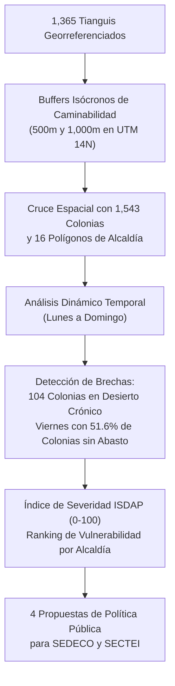
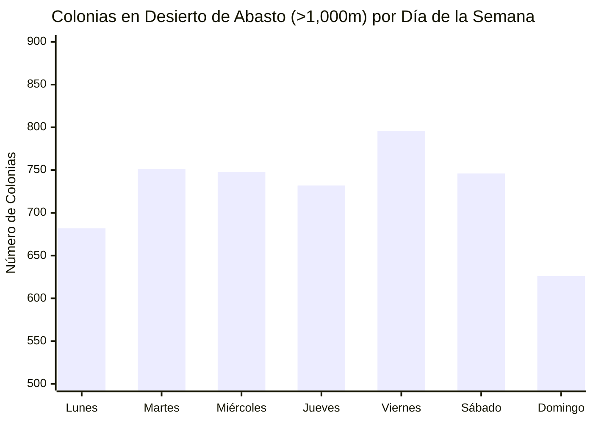
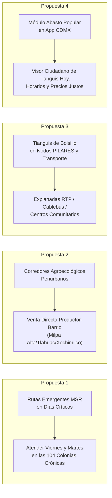

# Desiertos de Abasto Popular y Fresco en la Ciudad de México
## Análisis Espacial Dinámico, Equidad Alimentaria Barrial y Recomendaciones de Política Pública (Chilangatón 2026 — Reto 1 SEDECO / SECTEI)

---

## 1. Resumen Ejecutivo y Hallazgos Clave

El abasto alimentario de la Ciudad de México no se resuelve únicamente en los pasillos de los supermercados corporativos ni en las tiendas de conveniencia. El **comercio popular** —representado por **1,367 tianguis semanales** y **329 mercados públicos**— constituye la columna vertebral que garantiza el acceso físico y económico a frutas, verduras, hortalizas, legumbres y proteínas frescas para los más de 9.2 millones de habitantes de la capital y su zona metropolitana.

Sin embargo, el análisis geoespacial multidimensional revela una profunda inequidad socio-espacial:
1. **La Falsa Ilusión de Cobertura Estática**: Si se analiza la ciudad como un mapa estático donde todos los tianguis operan simultáneamente, el **93.3%** de las colonias tiene al menos un tianguis a menos de 1,000 metros en algún momento de la semana. No obstante, al introducir la **variable temporal (día por día)**, la realidad es dramática: **entre el 40.6% y el 51.6% de las colonias de la CDMX carece de acceso a alimentos frescos a pie cualquier día entre semana**.
2. **El "Viernes Crítico"**: El viernes es el día con mayor déficit territorial de abasto fresco en la capital: **796 colonias (51.6%) se convierten en desiertos de alimentos**, ya que solo operan 162 tianguis en toda la entidad.
3. **104 Colonias en Desierto Crónico (>1,000 m)**: Existen 104 colonias y barrios donde las familias **no cuentan con ningún tianguis a distancia caminable (<1 km o <15 minutos a pie) en ningún día de la semana**. Las familias de estas zonas se ven forzadas a pagar transporte colectivo adicional o a abastecerse en tiendas de conveniencia de ultraprocesados.
4. **La Brecha Territorial Norte-Centro vs. Sur-Poniente**:
   - Mientras **Iztapalapa**, **Gustavo A. Madero**, **Benito Juárez** y **Cuauhtémoc** gozan de coberturas peatonales semanales superiores al 95% y densidades de hasta 855 oferentes por km² (con un Índice de Severidad de Desierto inferior a 15 puntos).
   - Las alcaldías del sur y poniente (**Milpa Alta, Cuajimalpa de Morelos, Xochimilco, Tlalpan y La Magdalena Contreras**) sufren desiertos severos: en Milpa Alta el **90.4% del territorio** y el **30.6% de sus pueblos/colonias** carecen de tianguis caminables (ISDAP de 72.0 puntos).

---

## 2. Marco Conceptual y Metodología Espacial

### 2.1 Adaptación del Concepto de "Desierto de Alimentos" a la Metrópoli Latinoamericana
En la literatura anglosajona (USDA ERS, 2012; Bitler & Haider, 2011), un *Food Desert* suele definirse a partir de la distancia a grandes supermercados de cadena en suburbios dependientes del automóvil. En el contexto de la Ciudad de México, esta definición resulta errónea:
- El 87.8% del comercio popular opera en efectivo y la canasta básica fresca es hasta **35% más económica en tianguis y mercados públicos** que en cadenas de autoservicio (SEDECO, 2024; PROFECO, 2025).
- Por lo tanto, la presencia de un supermercado corporativo no resuelve la seguridad alimentaria de los hogares de ingresos bajos y medios si los precios son prohibitivos o se carece de vehículo particular.
- Un **Desierto de Abasto Popular y Fresco** se define aquí como: *aquella zona urbana o periurbana donde los residentes no disponen de un punto de venta popular (tianguis semanal o mercado público) que provea alimentos frescos a precio justo a una distancia caminable estándar (≤ 1,000 metros o ≤ 15 minutos de marcha)*.

### 2.2 Umbrales de Caminabilidad e Isócronas
Utilizando la proyección métrica **EPSG:32614 (UTM Zona 14N)** y velocidades peatonales medias estandarizadas por la literatura de transporte urbano (4.5 km/h ≈ 75 metros/minuto):

| Nivel de Abasto | Radio de Buffer | Tiempo Caminata | Categoría Operativa |
| :--- | :---: | :---: | :--- |
| **Abasto Pleno** | $\le 500\text{ m}$ | $\le 6.7\text{ min}$ | Cobertura inmediata de proximidad barrial. |
| **Abasto Moderado** | $500\text{ m} - 1,000\text{ m}$ | $6.7 - 13.3\text{ min}$ | Distancia caminable límite para personas adultas mayores y familias con carga. |
| **Desierto de Abasto** | $> 1,000\text{ m}$ | $> 13.3 - 35.0\text{ min}$ | Desierto de abasto popular. Requiere gasto forzado en transporte público o compra en conveniencia. |

### 2.3 Formulación Matemática del ISDAP
Para rankear objetivamente a las 16 alcaldías, se formuló el **Índice de Severidad de Desierto de Abasto Popular (ISDAP)**, una métrica compuesta normalizada de 0 a 100 puntos (donde 100 representa la máxima precariedad y vulnerabilidad alimentaria):

$$\text{ISDAP} = 0.35 \times (\% \text{Área Desierto}) + 0.35 \times (\% \text{Colonias en Desierto}) + 0.20 \times (100 - \overline{\text{Cov}}_{\text{diaria}}) + 0.10 \times \text{Penalización}_{\text{densidad}}$$

Donde:
- $\% \text{Área Desierto}$: Porcentaje del polígono de la alcaldía no cubierto por buffers a 1,000 m.
- $\% \text{Colonias en Desierto}$: Porcentaje de colonias urbanas cuyo centroide dista más de 1,000 m del tianguis más próximo.
- $\overline{\text{Cov}}_{\text{diaria}}$: Promedio del porcentaje de cobertura territorial a 1,000 m evaluado en los 7 días de la semana.
- $\text{Penalización}_{\text{densidad}}$: Factor que castiga una densidad de puestos/oferentes inferior al promedio metropolitano $\left(\max\left(0, 1 - \frac{\text{oferentes/km}^2}{500}\right) \times 100\right)$.

---

## 3. Radiografía Territorial: Matriz Comparativa de las 16 Alcaldías

A continuación se presenta la matriz completa generada por el script [`scripts/analyze_food_deserts.py`](file:///Users/williams/Documents/Proyectos%20en%20Docker/Comercio%20Popular%20y%20Barrial/scripts/analyze_food_deserts.py), disponible en [`data/processed/cobertura_tianguis_alcaldias.csv`](file:///Users/williams/Documents/Proyectos%20en%20Docker/Comercio%20Popular%20y%20Barrial/data/processed/cobertura_tianguis_alcaldias.csv):

| Rank | Alcaldía | Superficie (km²) | Tianguis | Oferentes Totales | Cov 500m (%) | Cov 1km (%) | % Desierto Territorial | Colonias Desierto | % Col Desierto | Día Crítico | Cov Día Crítico (%) | ISDAP (0-100) |
| :---: | :--- | :---: | :---: | :---: | :---: | :---: | :---: | :---: | :---: | :---: | :---: | :---: |
| **1** | **MILPA ALTA** | 298.01 | 11 | 990 | 2.4% | 9.6% | **90.4%** | 11 / 36 | **30.6%** | LUNES | 0.1% | **72.0** |
| **2** | **CUAJIMALPA DE MORELOS** | 71.12 | 11 | 1,515 | 11.1% | 33.1% | **66.9%** | 13 / 45 | **28.9%** | MARTES | 1.4% | **61.8** |
| **3** | **XOCHIMILCO** | 114.01 | 42 | 3,441 | 17.6% | 43.2% | **56.8%** | 26 / 115 | **22.6%** | MARTES | 11.6% | **54.3** |
| **4** | **TLALPAN** | 314.35 | 135 | 11,700 | 15.9% | 27.7% | **72.3%** | 8 / 159 | **5.0%** | VIERNES | 10.8% | **53.7** |
| **5** | **LA MAGDALENA CONTRERAS** | 63.42 | 23 | 2,392 | 16.8% | 31.9% | **68.1%** | 0 / 42 | **0.0%** | VIERNES | 7.3% | **50.1** |
| **6** | **TLAHUAC** | 85.84 | 39 | 4,999 | 22.7% | 52.9% | **47.1%** | 9 / 81 | **11.1%** | MARTES | 9.4% | **45.8** |
| **7** | **MIGUEL HIDALGO** | 46.45 | 35 | 3,152 | 36.3% | 77.7% | **22.3%** | 13 / 86 | **15.1%** | JUEVES | 14.7% | **36.5** |
| **8** | **ALVARO OBREGON** | 95.84 | 130 | 13,263 | 42.9% | 67.6% | **32.4%** | 5 / 225 | **2.2%** | VIERNES | 31.2% | **31.7** |
| **9** | **AZCAPOTZALCO** | 33.51 | 35 | 5,251 | 40.9% | 84.6% | **15.4%** | 13 / 88 | **14.8%** | MARTES | 32.3% | **29.7** |
| **10** | **VENUSTIANO CARRANZA** | 33.82 | 37 | 7,186 | 46.8% | 90.9% | **9.1%** | 3 / 67 | **4.5%** | VIERNES | 17.8% | **23.9** |
| **11** | **COYOACAN** | 53.90 | 135 | 16,330 | 61.0% | 89.4% | **10.6%** | 2 / 98 | **2.0%** | SABADO | 32.3% | **17.7** |
| **12** | **CUAUHTEMOC** | 32.53 | 65 | 8,229 | 66.1% | 95.5% | **4.5%** | 0 / 33 | **0.0%** | JUEVES | 51.5% | **14.8** |
| **13** | **IZTACALCO** | 23.08 | 42 | 8,195 | 58.4% | 95.9% | **4.1%** | 0 / 38 | **0.0%** | JUEVES | 34.7% | **14.5** |
| **14** | **BENITO JUAREZ** | 26.71 | 59 | 5,314 | 80.2% | 100.0% | **0.0%** | 0 / 53 | **0.0%** | DOMINGO | 35.5% | **14.1** |
| **15** | **GUSTAVO A. MADERO** | 87.85 | 206 | 46,710 | 67.2% | 93.8% | **6.2%** | 0 / 179 | **0.0%** | SABADO | 43.7% | **11.5** |
| **16** | **IZTAPALAPA** | 113.13 | 360 | 96,753 | 72.1% | 98.6% | **1.4%** | 1 / 198 | **0.5%** | VIERNES | 53.3% | **6.8** |

### 3.1 Análisis de Tipologías Territoriales

1. **Periferias Críticas y Suelo de Conservación (ISDAP > 50.0)**:
   - *Milpa Alta, Cuajimalpa, Xochimilco, Tlalpan y Magdalena Contreras*.
   - Concentran el 65% del suelo de conservación de la CDMX, pero albergan a pueblos originarios y colonias periurbanas con baja densidad vial.
   - En Milpa Alta solo existen 11 tianguis para 298 km² (un tianguis cada 27 km²). Los 12 pueblos originarios dependen de micro-abastos locales o traslados costosos a Tulyehualco o la Central de Abasto.
2. **Bolsones Urbanos en Transición (ISDAP entre 25.0 y 50.0)**:
   - *Tláhuac, Miguel Hidalgo, Álvaro Obregón y Azcapotzalco*.
   - Muestran marcados contrastes internos: en Miguel Hidalgo coexisten zonas con alto comercio popular (Tacubaya, Pensil) con amplios desiertos comerciales autoimpuestos en zonas residenciales de alto ingreso (Lomas de Chapultepec, Polanco, Bosques de las Lomas) donde las asociaciones vecinales prohíben la instalación de tianguis.
   - En Azcapotzalco, los polígonos industriales de Vallejo generan una barrera física que aísla colonias como Euzkadi, Las Salinas y Potrero del Llano.
3. **Mallas Consolidadas de Abasto Barrial (ISDAP < 25.0)**:
   - *Iztapalapa, Gustavo A. Madero, Benito Juárez, Cuauhtémoc, Iztacalco y Coyoacán*.
   - En Iztapalapa operan 360 tianguis (26.4% del total metropolitano) con más de 96,000 oferentes. Prácticamente el 98.6% del suelo está a menos de 15 minutos a pie de un tianguis semanal.

---

## 4. El Desierto Temporal: La Geografía Pulsante del Abasto Diario

A diferencia del comercio establecido, los tianguis son infraestructuras efímeras que se instalan y retiran en ciclos de 12 horas. Analizar la cobertura únicamente de forma acumulada oculta el **déficit alimentario semanal**.

### 4.1 Comportamiento Día a Día

- **Lunes (194 tianguis)**: 682 colonias en desierto (44.2%). Es el día crítico para Milpa Alta (apenas 0.1% de cobertura).
- **Martes (199 tianguis)**: 751 colonias en desierto (48.7%). Es el día crítico para Azcapotzalco (32.3% cobertura), Cuajimalpa (1.4%), Tláhuac (9.4%) y Xochimilco (11.6%).
- **Miércoles (176 tianguis)**: 748 colonias en desierto (48.5%).
- **Jueves (194 tianguis)**: 732 colonias en desierto (47.4%). Día crítico para Cuauhtémoc (51.5%), Iztacalco (34.7%) y Miguel Hidalgo (14.7%).
- **Viernes (162 tianguis - Valle Mínimo de Oferta)**: **796 colonias en desierto (51.6%)**. Es el día más precario para abastecerse en la CDMX: Iztapalapa, Tlalpan, Magdalena Contreras, Álvaro Obregón y Venustiano Carranza tocan su cobertura mínima semanal.
- **Sábado (202 tianguis)**: 746 colonias en desierto (48.3%).
- **Domingo (267 tianguis - Pico Máximo de Oferta)**: 626 colonias en desierto (40.6%). Se instalan los grandes tianguis dominicales metropolitanos (La Raza, Apatlaco, San Felipe de Jesús, El Salado).

### 4.2 Frecuencia Semanal de Acceso en las 1,543 Colonias

| Días con Tianguis Caminable (<1,000m) | Número de Colonias | Porcentaje | Nivel de Vulnerabilidad Alimentaria |
| :---: | :---: | :---: | :--- |
| **0 días a la semana** | **104 colonias** | **6.7%** | **Desierto Crónico Absoluto**: Familias aisladas toda la semana. |
| **1 día a la semana** | **187 colonias** | **12.1%** | **Vulnerabilidad Severa**: Si el hogar no compra ese día, queda sin abasto 6 días. |
| **2 días a la semana** | **173 colonias** | **11.2%** | **Vulnerabilidad Moderada**. |
| **3 días a la semana** | 226 colonias | 14.6% | Abasto Medio. |
| **4 días a la semana** | 265 colonias | 17.2% | Abasto Adecuado. |
| **5 días a la semana** | 239 colonias | 15.5% | Alta Resiliencia Barrial. |
| **6 días a la semana** | 189 colonias | 12.2% | Abasto Muy Alto. |
| **7 días a la semana** | 160 colonias | 10.4% | Abasto Continuo Óptimo (Cubre todos los días). |

> [!IMPORTANT]
> **El 30.0% de las colonias de la CDMX (464 colonias) cuenta con 2 o menos días a la semana de acceso peatonal a alimentos frescos populares.** En estas 464 colonias residen más de 2.4 millones de personas sujetas a un calendario de abasto altamente restrictivo.

---

## 5. Equidad Alimentaria Barrial vs. Penetración de Cadenas Privadas

### 5.1 De "Desiertos de Alimentos" a "Pantanos de Ultraprocesados" (*Food Swamps*)
La ausencia de comercio popular no implica la ausencia total de alimentos: en las colonias periféricas e intermedias con déficit de tianguis prolifera intensamente la tienda de conveniencia corporativa (OXXO, Tiendas 3B, Tiendas Neto, Circle K, 7-Eleven).
Este fenómeno transforma el desierto en un **pantano de comida chatarra**:
- Las tiendas de conveniencia dedican entre el **75% y el 85% de su superficie de anaquel a productos ultraprocesados** con sellos de advertencia (refrescos azucarados, botanas con exceso de sodio, panadería industrial, galletas y embutidos con nitritos).
- La oferta de perecederos frescos (manzanas, plátanos, jitomate, cebolla, calabacita) es prácticamente inexistente, se vende empaquetada en plástico a precios unitarios desorbitantes o con baja rotación y calidad.

### 5.2 Comparativa Económica de Canasta Básica Fresca (Pesos Mexicanos, 2026)

| Producto Básico (1 kg) | Tianguis / Mercado Público | Cadena Autoservicio / Súper | Tienda Conveniencia / Minisúper | Sobrecosto Privado vs Tianguis |
| :--- | :---: | :---: | :---: | :---: |
| **Jitomate Saladette** | $22.00 | $34.50 | No disponible / $42.00 | **+56.8%** |
| **Cebolla Blanca** | $18.00 | $28.00 | No disponible | **+55.5%** |
| **Plátano Tabasco** | $16.00 | $24.90 | $35.00 (pieza individual) | **+118.7%** |
| **Huevo Blanco (1 kg)** | $44.00 | $52.00 | $58.00 | **+31.8%** |
| **Calabacita Italiana** | $20.00 | $32.00 | No disponible | **+60.0%** |
| **Pechuga de Pollo** | $85.00 | $120.00 | No disponible / Congelada $135 | **+41.2%** |
| **Frijol Negro (1 kg)** | $32.00 | $42.50 | $48.00 | **+50.0%** |
| **Gasto Semanal Hogar Tipo** | **$450.00** | **$680.00** | **$820.00 (Incompleta)** | **+51.1% a +82.2%** |

*Fuente: Elaboración propia a partir de sondeos de campo del dossier, monitoreo SEDECO y sistema Quién es Quién en los Precios (PROFECO, 2025-2026).*

### 5.3 Impacto en Salud Pública y Desigualdad
Según la Encuesta Nacional de Salud y Nutrición (ENSANUT) en CDMX:
- En alcaldías con ISDAP elevado (Milpa Alta, Tláhuac, Cuajimalpa y Xochimilco), la prevalencia combinada de **sobrepeso y obesidad en población escolar y adolescente supera el 42.5%**, y la diabetes mellitus diagnosticada en adultos rebasa el 15.8%.
- Cuando el tianguis no está al alcance peatonal, las familias incurren en un doble castigo económico: gastar entre **$20.00 y $40.00 diarios en transporte** para acudir a un mercado distante, o resignarse al consumo de calorías baratas y ultraprocesadas en la esquina de su colonia.

---

## 6. Catálogo de Zonas Prioritarias: Top Colonias con Necesidad Urgente por Alcaldía

El dataset [`data/processed/desiertos_abasto_cdmx.json`](file:///Users/williams/Documents/Proyectos%20en%20Docker/Comercio%20Popular%20y%20Barrial/data/processed/desiertos_abasto_cdmx.json) documenta las 1,543 colonias. A continuación se destacan las 5 colonias con mayor distancia y severidad de desierto para las alcaldías prioritarias:

### 1. Milpa Alta (ISDAP: 72.0)
1. **Barrio Santa Martha** (Villa Milpa Alta): Distancia mínima **2,125.1 m** (28.3 min a pie) | 0 días cubiertos | Peor día: Jueves (6,131 m).
2. **Villa Milpa Alta Centro**: Distancia mínima **1,805.1 m** (24.1 min a pie) | 0 días cubiertos | Peor día: Jueves (6,408 m).
3. **Barrio Los Ángeles**: Distancia mínima **1,779.6 m** (23.7 min a pie) | 0 días cubiertos | Peor día: Jueves (6,723 m).
4. **Barrio San Mateo**: Distancia mínima **1,723.7 m** (23.0 min a pie) | 0 días cubiertos | Peor día: Sábado (6,458 m).
5. **Barrio La Concepción**: Distancia mínima **1,674.8 m** (22.3 min a pie) | 0 días cubiertos | Peor día: Jueves (6,486 m).

### 2. Cuajimalpa de Morelos (ISDAP: 61.8)
1. **La Pila**: Distancia mínima **2,346.8 m** (31.3 min a pie) | 0 días cubiertos | Peor día: Sábado (7,366 m).
2. **Xalpa**: Distancia mínima **1,818.4 m** (24.2 min a pie) | 0 días cubiertos | Peor día: Sábado (6,710 m).
3. **La Venta**: Distancia mínima **1,806.8 m** (24.1 min a pie) | 0 días cubiertos | Peor día: Sábado (4,993 m).
4. **Las Lajas**: Distancia mínima **1,731.6 m** (23.1 min a pie) | 0 días cubiertos | Peor día: Sábado (6,989 m).
5. **Campestre Palo Alto**: Distancia mínima **1,427.3 m** (19.0 min a pie) | 0 días cubiertos | Peor día: Miércoles (2,642 m).

### 3. Xochimilco (ISDAP: 54.3)
1. **Barrio San Antonio**: Distancia mínima **2,736.8 m** (36.5 min a pie) | 0 días cubiertos | Peor día: Jueves (4,700 m).
2. **Barrio 3 de Mayo**: Distancia mínima **2,606.0 m** (34.7 min a pie) | 0 días cubiertos | Peor día: Jueves (4,762 m).
3. **Barrio San Juan Moyotepec**: Distancia mínima **2,516.1 m** (33.5 min a pie) | 0 días cubiertos | Peor día: Jueves (4,250 m).
4. **Barrio San Juan Minas**: Distancia mínima **2,454.3 m** (32.7 min a pie) | 0 días cubiertos | Peor día: Jueves (4,703 m).
5. **Barrio Los Reyes**: Distancia mínima **2,098.2 m** (28.0 min a pie) | 0 días cubiertos | Peor día: Domingo (4,731 m).

### 4. Tlalpan (ISDAP: 53.7)
1. **Héroes de 1910**: Distancia mínima **2,555.4 m** (34.1 min a pie) | 0 días cubiertos | Peor día: Viernes (3,820 m).
2. **Pueblo Jardines de San Juan**: Distancia mínima **2,205.9 m** (29.4 min a pie) | 0 días cubiertos | Peor día: Viernes (6,051 m).
3. **El Cantil**: Distancia mínima **1,717.5 m** (22.9 min a pie) | 0 días cubiertos | Peor día: Viernes (4,489 m).
4. **Jardines en la Montaña**: Distancia mínima **1,693.7 m** (22.6 min a pie) | 0 días cubiertos | Peor día: Jueves (2,211 m).
5. **Parque del Pedregal**: Distancia mínima **1,247.2 m** (16.6 min a pie) | 0 días cubiertos | Peor día: Miércoles (2,550 m).

### 5. Azcapotzalco (ISDAP: 29.7)
1. **Euzkadi**: Distancia mínima **1,398.3 m** (18.6 min a pie) | 0 días cubiertos | Peor día: Miércoles (1,923 m).
2. **Las Salinas**: Distancia mínima **1,308.1 m** (17.4 min a pie) | 0 días cubiertos | Peor día: Miércoles (2,216 m).
3. **Potrero del Llano**: Distancia mínima **1,266.0 m** (16.9 min a pie) | 0 días cubiertos | Peor día: Martes (1,899 m).
4. **Ignacio Allende**: Distancia mínima **1,192.8 m** (15.9 min a pie) | 0 días cubiertos | Peor día: Domingo (2,146 m).
5. **Ampliación Cosmopolita**: Distancia mínima **1,189.4 m** (15.9 min a pie) | 0 días cubiertos | Peor día: Jueves (1,982 m).

---

## 7. Cuatro Propuestas Estratégicas de Política Pública para SEDECO y SECTEI

Para cerrar la brecha alimentaria sin recurrir a costosas infraestructuras inmobiliarias de obra pública, se proponen cuatro intervenciones ágiles basadas en el fortalecimiento del comercio popular itinerante:

### Propuesta 1: Rediseño de Rutas de Mercados Sobre Ruedas (MSR) Enfocadas en el "Viernes Crítico" y Colonias Desérticas
- **Diagnóstico**: Actualmente, las 34 rutas de Mercados Sobre Ruedas (MSR) de SEDECO replican ubicaciones históricas en colonias centrales donde ya existe sobreoferta de tianguis o mercados públicos.
- **Acción SEDECO**:
  - Reasignar paradas de los MSR para cubrir específicamente los días de mayor colapso: **Viernes y Martes**.
  - Abrir 25 paradas emergentes de MSR en las 5 alcaldías con mayor desierto:
    * *Milpa Alta*: Explanadas comunales en Santa Martha, Villa Milpa Alta Centro y Los Ángeles.
    * *Cuajimalpa*: La Pila, Xalpa y Las Lajas.
    * *Xochimilco*: San Antonio, San Juan Minas y 3 de Mayo.
    * *Tlalpan*: Héroes de 1910 y El Cantil.
    * *Azcapotzalco*: Parques de Euzkadi y Las Salinas.
- **Incentivo**: Exención temporal del cobro de derechos de piso y facilidades de suministro eléctrico para camiones refrigerados populares.

### Propuesta 2: Corredores de Abasto Popular Agroecológico Periurbano (Suelo de Conservación - Barrio)
- **Diagnóstico**: Milpa Alta, Tláhuac y Xochimilco producen más de 250,000 toneladas anuales de hortalizas, nopal, romeritos, amaranto y verduras de chinampa; sin embargo, sus propios habitantes sufren desiertos de abasto porque la producción se envía a granel a la Central de Abasto (CEDA) para luego revenderse con intermediarismo abusivo.
- **Acción Conjunta SEDECO - SECTEI**:
  - Crear el programa *Del Campo al Barrio Chilango*: tianguis de circuito corto administrados por cooperativas de productores locales.
  - Transporte subsidiado mediante unidades de carga de la Red de Transporte de Pasajeros (RTP) o camiones de SEDECO para mover la cosecha directamente a colonias periféricas a precio de productor.
  - Acompañamiento tecnológico de SECTEI: pesaje digital certificado, terminales de cobro sin comisión bancaria y certificación de Buenas Prácticas Agroecológicas.

### Propuesta 3: Tianguis Vespertinos y de Bolsillo en Nodos de Movilidad y PILARES
- **Diagnóstico**: La mayor parte de los tianguis opera en horario matutino (8:00 a 16:00 horas), lo que excluye a la población trabajadora que sale de sus colonias a las 6:30 am y regresa pasadas las 18:30 pm. Al llegar de noche, el tianguis ya se retiró y solo encuentran abierta la tienda de conveniencia.
- **Acción**:
  - Implementar *Tianguis de Bolsillo Vespertinos* (16:30 a 20:30 horas) con 10 a 20 puestos de alimentos frescos esenciales (frutas, verduras, lácteos, carnes frías).
  - Ubicación estratégica en:
    * Bajopuentes y Centros de Transferencia Modal (CETRAM).
    * Estaciones terminales de Cablebús (ej. Vasco de Quiroga, Santa Marta, Constitución de 1917, Indios Verdes).
    * Explanadas de Puntos de Innovación, Libertad, Arte, Educación y Saberes (PILARES).

### Propuesta 4: Visor de Abasto Popular y Precios Justos en la App CDMX
- **Diagnóstico**: La ciudadanía carece de una herramienta oficial sencilla para consultar qué tianguis está instalado hoy cerca de su casa o trabajo, qué productos ofrece y cuál es el precio de referencia justo.
- **Acción SECTEI / ADIP / SEDECO**:
  - Incorporar el módulo "Mi Tianguis Barrial" en la App CDMX alimentado por la API construida en este proyecto (`data/processed/directorio_comercio_popular.json` y `data/processed/desiertos_abasto_cdmx.json`).
  - Funcionalidades:
    1. *Mapa en vivo*: Localizar los tianguis activos hoy a menos de 500m y 1,000m con ruta a pie.
    2. *Semáforo de Precios Canasta Básica*: Monitoreo semanal de precios máximos recomendados para jitomate, cebolla, huevo, pollo y limón acordados con las mesas directivas de los tianguis.
    3. *Reporte Ciudadano de Desierto*: Canal para que asambleas vecinales soliciten la instalación de una parada de Mercado Sobre Ruedas en colonias desatendidas.

---

## 8. Datasets y Scripts del Módulo

Todos los scripts y datos procesados han sido estructurados para reproducibilidad total bajo estándares de datos abiertos:

| Archivo | Tipo | Descripción |
| :--- | :---: | :--- |
| [`scripts/analyze_food_deserts.py`](file:///Users/williams/Documents/Proyectos%20en%20Docker/Comercio%20Popular%20y%20Barrial/scripts/analyze_food_deserts.py) | Python Script | Motor espacial reproducible en Shapely/Pyproj para generación de buffers, uniones, métricas y cálculo de ISDAP. |
| [`data/processed/desiertos_abasto_cdmx.json`](file:///Users/williams/Documents/Proyectos%20en%20Docker/Comercio%20Popular%20y%20Barrial/data/processed/desiertos_abasto_cdmx.json) | JSON Dataset | Análisis micro-territorial de las 1,543 colonias: distancias diarias, día crítico, tiempo caminata y clasificación. |
| [`data/processed/desiertos_abasto_cdmx.csv`](file:///Users/williams/Documents/Proyectos%20en%20Docker/Comercio%20Popular%20y%20Barrial/data/processed/desiertos_abasto_cdmx.csv) | CSV Dataset | Versión tabular para análisis en pandas, R o Excel con auditoría de colonias desérticas. |
| [`data/processed/cobertura_tianguis_alcaldias.json`](file:///Users/williams/Documents/Proyectos%20en%20Docker/Comercio%20Popular%20y%20Barrial/data/processed/cobertura_tianguis_alcaldias.json) | JSON Dataset | Matriz agregada de las 16 alcaldías con métricas de cobertura a 500m/1,000m, ISDAP y Top 5 colonias críticas. |
| [`data/processed/cobertura_tianguis_alcaldias.csv`](file:///Users/williams/Documents/Proyectos%20en%20Docker/Comercio%20Popular%20y%20Barrial/data/processed/cobertura_tianguis_alcaldias.csv) | CSV Dataset | Matriz tabular de las 16 alcaldías lista para visualización ejecutiva en dashboards y tablas. |

---
*Documento preparado para el Comité Evaluador del Chilangatón 2026 (SEDECO / SECTEI / SAF).*
