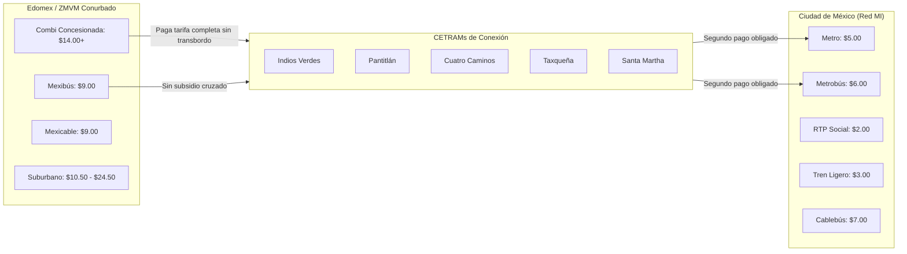

# Catálogo Maestro y Motor de Tarifas, Horarios y Asimetría Metropolitana de Transporte (CDMX vs. Edomex)

**Proyecto:** Comercio Popular, Barrial y Movilidad Integrada en la CDMX  
**Marco:** Chilangatón 2026 — Reto 1: Comercio Popular y Barrial (SEDECO / SECTEI / SAF)  
**Ubicación:** `docs/TARIFAS_Y_HORARIOS_TRANSPORTE.md`  
**Datasets Asociados:** [`data/catalog/tarifas_horarios_transporte.json`](file:///Users/williams/Documents/Proyectos%20en%20Docker/Comercio%20Popular%20y%20Barrial/data/catalog/tarifas_horarios_transporte.json) y [`data/catalog/tarifas_horarios_transporte.csv`](file:///Users/williams/Documents/Proyectos%20en%20Docker/Comercio%20Popular%20y%20Barrial/data/catalog/tarifas_horarios_transporte.csv)  
**Motor de Ruteo y Cotización:** [`scripts/schedule_pricing_engine.py`](file:///Users/williams/Documents/Proyectos%20en%20Docker/Comercio%20Popular%20y%20Barrial/scripts/schedule_pricing_engine.py)  

---

## 1. Resumen Ejecutivo y Marco Normativo

El sistema de transporte público de la Zona Metropolitana del Valle de México (ZMVM) no es un sistema unificado, sino un mosaico fragmentado gobernado por tres jurisdicciones regulatorias: la **Ciudad de México (SEMOVI)**, el **Estado de México (Secretaría de Movilidad del Edomex)** y la **Federación (SICT)**.

Esta fragmentación genera una de las brechas de equidad urbana más pronunciadas de América Latina:
1. **En la Ciudad de México:** El transporte público institucional de la Red de **Movilidad Integrada (MI)** opera con un fuerte subsidio gubernamental, manteniendo tarifas congeladas y accesibles entre **$2.00 y $7.00 MXN** (Metro $5.00, Metrobús $6.00, RTP $2.00-$4.00, Cablebús $7.00, Trolebús $4.00, Tren Ligero $3.00), integrados a través de la Tarjeta MI.
2. **En el Estado de México:** El transporte concesionado (combis, vagonetas y microbuses) opera bajo un esquema privado desregulado cuya **tarifa mínima oficial publicada en Gaceta Oficial del Gobierno del Estado de México es de $14.00 MXN para los primeros 5 kilómetros**, más **$0.25 MXN por cada kilómetro adicional**. Además, carece de transbordos gratuitos y no reconoce gratuidades sociales de ley para personas adultas mayores.
3. **El fenómeno del transbordo metropolitano en CETRAMs:** Más de 5.8 millones de viajes diarios cruzan la frontera conurbada hacia paraderos clave de la CDMX (*Indios Verdes, Pantitlán, Cuatro Caminos, Taxqueña, Constitución de 1917, Santa Martha*). Un comerciante o comprador que viaja desde municipios periféricos como Ecatepec, Nezahualcóyotl, Chimalhuacán, Valle de Chalco o Naucalpan debe pagar de entrada **$14.00 a $18.00 MXN** en su combi local antes de transbordar al Metro o Metrobús de $5 o $6 MXN, duplicando o triplicando el costo de su traslado diario.

---

## 2. Tabla Maestra de Subsistemas, Horarios y Tarifas

A continuación se detalla la matriz de los **15 subsistemas de transporte** modelados en el catálogo dinámico:

| Subsistema ID | Nombre del Subsistema | Jurisdicción | Red Tipo | Horario L-V | Horario Sáb | Horario Dom/Fest | Tarifa Base Diurna | Esquema Cobro | Recargo Nocturno | Medio de Pago | Gratuidades Clave |
|---|---|:---:|:---:|:---:|:---:|:---:|:---:|:---:|:---:|:---:|---|
| `METRO` | STC Metro | CDMX | `PRIMARIA_MI` | 05:00 - 24:00 | 06:00 - 24:00 | 07:00 - 24:00 | **$5.00** | Única | No opera noche | Tarjeta MI | +60 años, discapacidad, <5 años |
| `METROBUS` | Metrobús CDMX (BRT) | CDMX | `PRIMARIA_MI` | 04:30 - 24:00 | 04:30 - 24:00 | 05:00 - 24:00 | **$6.00** | Única | No opera noche | Tarjeta MI | +60 años, discapacidad, <5 años |
| `CABLEBUS` | Cablebús Teleférico | CDMX | `PRIMARIA_MI` | 05:00 - 23:00 | 06:00 - 23:00 | 07:00 - 23:00 | **$7.00** | Única | No opera noche | Tarjeta MI | +60 años, discapacidad, <5 años |
| `TROLEBUS` | Trolebús STE | CDMX | `PRIMARIA_MI` | 05:00 - 24:00 | 05:00 - 24:00 | 05:30 - 23:30 | **$4.00** | Única | Sí (Fijo $7 Nochebús L1) | Tarjeta MI | +60 años, discapacidad, <5 años |
| `TREN_LIGERO` | STE Tren Ligero | CDMX | `PRIMARIA_MI` | 05:00 - 23:30 | 05:30 - 23:30 | 06:30 - 23:30 | **$3.00** | Única | No opera noche | Tarjeta MI | +60 años, discapacidad, <5 años |
| `RTP_ORDINARIO` | RTP Ordinario / Atenea | CDMX | `PRIMARIA_MI` | 05:00 - 23:00 | 05:00 - 23:00 | 06:00 - 23:00 | **$2.00** | Única | No aplica | MI / Efectivo | +60 años, discapacidad, <5 años |
| `RTP_EXPRESO` | RTP Expreso | CDMX | `PRIMARIA_MI` | 05:00 - 23:00 | 05:00 - 23:00 | 06:00 - 23:00 | **$4.00** | Única | No aplica | MI / Efectivo | +60 años, discapacidad, <5 años |
| `RTP_ECOBUS` | RTP Ecobús Santa Fe | CDMX | `PRIMARIA_MI` | 05:00 - 23:00 | 05:00 - 23:00 | 06:00 - 23:00 | **$5.00** | Única | No aplica | MI / Efectivo | +60 años, discapacidad, <5 años |
| `RTP_NOCHEBUS` | RTP Red Nochebús | CDMX | `PRIMARIA_MI` | 00:00 - 05:00 | 00:00 - 05:00 | 00:00 - 05:00 | **$7.00** | Única | Tarifa fija $7 | MI / Efectivo | +60 años, discapacidad, <5 años |
| `CONCESIONADO_CDMX_MICROBUS` | Microbús y Vagoneta | CDMX | `SECUNDARIA_CONCESIONADA` | 05:00 - 23:00 | 05:30 - 23:00 | 06:00 - 22:30 | **$6.00** | Distancia (km) | +20% (23:00-06:00) | Efectivo operador | Menores en regazo (sin gratuidad +60) |
| `CONCESIONADO_CDMX_CORREDOR` | Corredor Concesionado | CDMX | `SECUNDARIA_CONCESIONADA` | 05:00 - 23:30 | 05:30 - 23:00 | 06:00 - 22:30 | **$8.00** | Distancia (km) | +20% (23:00-06:00) | Tarjeta MI / Efectivo | Variable por empresa |
| `CONCESIONADO_EDOMEX_COMBI` | Combi Mexiquense | EDOMEX | `METROPOLITANA_EDOMEX` | 04:30 - 23:00 | 04:30 - 23:00 | 05:30 - 22:30 | **$14.00** | Distancia (km) | +20% nocturno de facto | Efectivo operador | Sin gratuidades por ley |
| `MEXIBUS` | Mexibús BRT | EDOMEX | `METROPOLITANA_EDOMEX` | 04:30 - 24:00 | 04:30 - 24:00 | 05:00 - 23:30 | **$9.00** | Única | No opera noche | Mexipase | +60 años, discapacidad, <5 años |
| `MEXICABLE` | Teleférico Mexicable | EDOMEX | `METROPOLITANA_EDOMEX` | 04:30 - 23:00 | 05:30 - 22:00 | 07:00 - 21:00 | **$9.00** | Única | No opera noche | Mexipase | +60 años, discapacidad, <5 años |
| `TREN_SUBURBANO` | Ferrocarril Suburbano | FEDERAL | `METROPOLITANA_EDOMEX` | 05:00 - 00:30 | 06:00 - 00:30 | 07:00 - 00:30 | **$10.50** | Zonal (Estaciones) | No aplica | Tarjeta Suburbano | <5 años (Adultos pagan completo) |

---

## 3. Fórmulas Matemáticas y Reglas de Cobro por Distancia

### 3.1. Transporte Concesionado de la Ciudad de México (Microbuses y Vagonetas)
Publicado por acuerdo de SEMOVI en la Gaceta Oficial de la CDMX:
$$\text{Tarifa Base}(d) = \begin{cases} 
\$6.00 \text{ MXN} & \text{si } d \le 5.0 \text{ km} \\
\$6.50 \text{ MXN} & \text{si } 5.0 < d \le 12.0 \text{ km} \\
\$7.50 \text{ MXN} & \text{si } d > 12.0 \text{ km}
\end{cases}$$

**Recargo Nocturno (23:00 a 06:00 hrs):**
$$\text{Tarifa Nocturna}(d) = \text{Tarifa Base}(d) \times 1.20$$
*Tramo hasta 5 km:* $\$6.00 \times 1.20 = \mathbf{\$7.20\text{ MXN}}$  
*Tramo de 5 a 12 km:* $\$6.50 \times 1.20 = \mathbf{\$7.80\text{ MXN}}$  
*Tramo mayor a 12 km:* $\$7.50 \times 1.20 = \mathbf{\$9.00\text{ MXN}}$  

### 3.2. Transporte Concesionado del Estado de México (Combis Metropolitanas)
Publicado en la Gaceta del Gobierno del Estado de México:
$$\text{Tarifa Base Edomex}(d) = \begin{cases} 
\$14.00 \text{ MXN} & \text{si } d \le 5.0 \text{ km} \\
\$14.00 + (d - 5.0) \times \$0.25 \text{ MXN} & \text{si } d > 5.0 \text{ km}
\end{cases}$$

**Recargo Nocturno (23:00 a 05:00 hrs):**
$$\text{Tarifa Nocturna Edomex}(d) = \text{Tarifa Base Edomex}(d) \times 1.20$$

### 3.3. Tren Suburbano (Buenavista - Cuautitlán)
Regulado por la SICT bajo concesión federal:
$$\text{Tarifa Suburbano}(d) = \begin{cases} 
\$10.50 \text{ MXN (Viaje Corto)} & \text{si } d \le 12.89 \text{ km (1 a 3 estaciones)} \\
\$24.50 \text{ MXN (Viaje Largo)} & \text{si } 12.89 < d \le 25.59 \text{ km (4 a 6 estaciones)}
\end{cases}$$

---

## 4. Comparativa Estructural: La Brecha de Precios CDMX vs. Edomex



### Estadísticas Clave de la Brecha:
1. **Diferencial en tarifa mínima:** La tarifa mínima de una combi mexiquense ($14.00) es **180% más costosa** que el Metro de la CDMX ($5.00) y **600% más costosa** que el servicio ordinario de RTP ($2.00).
2. **Costo de un viaje de 12 kilómetros:**
   - En **Metro CDMX**: $\$5.00\text{ MXN}$ (con transbordos ilimitados dentro de la red).
   - En **Metrobús CDMX**: $\$6.00\text{ MXN}$ (con ventana de transbordo de 2 horas).
   - En **Microbús concesionado CDMX**: $\$6.50\text{ MXN}$.
   - En **Combi concesionada Edomex**: $\$14.00 + (12 - 5) \times 0.25 = \mathbf{\$15.75\text{ MXN}}$.
   - En **Tren Suburbano**: $\mathbf{\$10.50\text{ MXN}}$ (viaje corto) o $\mathbf{\$24.50\text{ MXN}}$ si supera las 3 estaciones.

---

## 5. Impacto Socioeconómico en el Comercio Popular y Tianguis

### 5.1. La Economía del Madrugador (04:00 - 06:00 AM)
Los comerciantes de tianguis, locatarios de mercados públicos y vendedores ambulantes comienzan su jornada entre las **03:30 y las 05:00 de la mañana** para acudir a los centros mayoristas de abasto:
- **Central de Abasto de Iztapalapa (CEDA):** Tráfico intenso de descarga y venta al mayoreo de frutas, verduras y abarrotes de 04:00 a 08:00 AM.
- **Mercado de La Merced (Nave Mayor y Menor):** Abastecimiento de hortalizas, legumbres y cárnicos desde las 04:30 AM.
- **Mercado de La Nueva Viga:** El segundo mercado mayorista de pescados y mariscos del mundo opera en su hora pico de 03:00 a 06:30 AM.

#### El Vaciado Nocturno de Transporte Masivo:
Entre las 00:00 y las 05:00 hrs, **el Metro está 100% cerrado**. El único servicio institucional público disponible es la red de **RTP Nochebús ($7.00 MXN)** y la Línea 1 de Trolebús Eje Central ($7.00 MXN), pero su cobertura radial no penetra en la periferia profunda de Iztapalapa, Gustavo A. Madero, Tláhuac, ni en los municipios mexiquenses.

Por ello, el comerciante que madruga depende obligatoriamente de:
1. **Combis y microbuses concesionados:** Que comienzan a salir a las 04:30 AM cobrando **tarifa con recargo nocturno (+20%)**: un trayecto de combi mexiquense a las 04:45 AM cuesta entre **$16.80 y $21.00 MXN**.
2. **Taxis de sitio y fletes colectivos:** Con tarifas no reguladas de $80 a $250 MXN por viaje de abasto.

### 5.2. El Sobrecosto por Traslado de Mercancías y Bultos
En el transporte público masivo institucional (Metro, Metrobús, Cablebús):
- El reglamento prohíbe el acceso con "bultos voluminosos que estorben a los usuarios", lo que obliga al comerciante a recurrir al transporte concesionado o pagar sobornos informales a los choferes ("cobro de pasaje doble" por costal o diablito).
- En microbuses y combis, es costumbre generalizada que **por cada diablito, caja de jitomate o costal de mercancía se cobre un pasaje completo adicional ($6.00 a $14.00 MXN extra)**.

### 5.3. Exclusión Financiera y Dependencia del Efectivo
El **87.8% del comercio popular opera estrictamente en efectivo**. Aunque la Red MI de la CDMX ya exige el 100% de pago con Tarjeta MI o medios electrónicos contactless, el transporte concesionado secundario (tanto microbuses en CDMX como combis en Edomex) **solo acepta efectivo exacto mano a mano con el chofer**.
- Esta fricción obliga al comerciante a conservar cambio fraccionario en monedas ($0.50, $1.00, $2.00, $5.00, $10.00), sufriendo pérdidas por redondeo o abusos de cambio por parte de los operadores durante la noche y madrugada.

### 5.4. Adultos Mayores Comerciantes en la Periferia
Una proporción significativa de puesteros en tianguis y mercados sobre ruedas son personas de más de 60 años.
- En CDMX, el Metro, RTP, Trolebús, Cablebús y Tren Ligero les garantizan **100% de gratuidad** presentando credencial INAPAM o Tarjeta Bienestar.
- Al cruzar la frontera hacia el Estado de México o al subir a un microbús concesionado, **pierden totalmente el subsidio** y deben desembolsar el pasaje completo de $14.00+ MXN, lo que merma drásticamente su margen de ganancia en cada jornada.

---

## 6. Manual de Uso del Motor de Tarifas (`schedule_pricing_engine.py`)

El módulo [`scripts/schedule_pricing_engine.py`](file:///Users/williams/Documents/Proyectos%20en%20Docker/Comercio%20Popular%20y%20Barrial/scripts/schedule_pricing_engine.py) provee dos funciones programáticas clave y una interfaz CLI de alto rendimiento.

### 6.1. Integración en Código Python

```python
from scripts.schedule_pricing_engine import TransitPricingEngine

engine = TransitPricingEngine()

# 1. Consultar estado y costos de toda la red a una hora determinada
resultado_hora = engine.consultar_transporte_por_hora(dia="DOMINGO", hora_decimal=2.5)
print(f"Sistemas en operación: {resultado_hora['resumen_estadistico']['total_abiertos']}")
# Imprime: 1 (RTP_NOCHEBUS abierto, el resto cerrado)

# 2. Cotizar un tramo de 14.5 km en combi mexiquense en horario nocturno
cotizacion = engine.calcular_costo_tramo(
    sistema_id="CONCESIONADO_EDOMEX_COMBI",
    distancia_km=14.5,
    hora_decimal=23.5,
    dia="LUNES"
)
print(f"Costo final: ${cotizacion['costo_final']} MXN (Tarifa nocturna: {cotizacion['es_nocturno']})")
# Imprime: Costo final: $19.66 MXN (Tarifa nocturna: True)

# 3. Cotizar cruce fronterizo Edomex -> CDMX
cruce = engine.calcular_costo_tramo(
    sistema_id="CONCESIONADO_CDMX_MICROBUS",
    distancia_km=8.0,
    hora_decimal=7.0,
    origen_edomex=True
)
print(f"Tarifa metropolitana aplicada: ${cruce['costo_final']} MXN")
# Imprime: $14.75 MXN (Aplica regla de reciprocidad Edomex)
```

### 6.2. Ejemplos de Ejecución en Línea de Comandos (CLI)

```bash
# Consultar qué sistemas operan el domingo a las 02:30 AM
python3 scripts/schedule_pricing_engine.py --hora 2.5 --dia DOMINGO

# Consultar disponibilidad en hora pico matutina de lunes a las 05:30 AM
python3 scripts/schedule_pricing_engine.py --hora 5.5 --dia LUNES

# Calcular costo de trayecto de 12 km en Combi Edomex a las 23:30 hrs
python3 scripts/schedule_pricing_engine.py --sistema CONCESIONADO_EDOMEX_COMBI --distancia 12.0 --hora 23.5

# Calcular costo en Microbús CDMX para 8 km en horario diurno
python3 scripts/schedule_pricing_engine.py --sistema CONCESIONADO_CDMX_MICROBUS --distancia 8.0 --hora 14.0

# Exportar resultado en formato JSON para consumo de frontend/API
python3 scripts/schedule_pricing_engine.py --hora 6.0 --dia LUNES --json

# Ejecutar suite de pruebas de exactitud matemática (10 pruebas)
python3 scripts/schedule_pricing_engine.py --test
```

---

## 7. Referencias Normativas y Fuentes Oficiales

1. **Gaceta Oficial de la Ciudad de México:** *Acuerdo por el que se autoriza el ajuste a las tarifas del Servicio de Transporte Público Colectivo de Pasajeros Concesionado en la CDMX*, Secretaría de Movilidad (SEMOVI).
2. **Gaceta del Gobierno del Estado de México:** *Acuerdo por el que se fijan las tarifas máximas autorizadas para el Servicio Público de Transporte Concesionado de Pasajeros en el Estado de México*, Secretaría de Movilidad del GEM.
3. **Reglamento del Ferrocarril Suburbano de la Zona Metropolitana del Valle de México:** Tarifas publicadas en el Diario Oficial de la Federación (DOF) por Ferrocarriles Suburbanos S.A.P.I. de C.V. y la SICT.
4. **Lineamientos y Tarifas de la Red de Movilidad Integrada (MI):** Portal SEMOVI CDMX (`https://www.semovi.cdmx.gob.mx/`).
5. **Dossier de Campo Chilangatón 2026:** *Diagnóstico Socioeconómico y Logístico del Comercio Popular y Mercados Públicos de la CDMX*.
